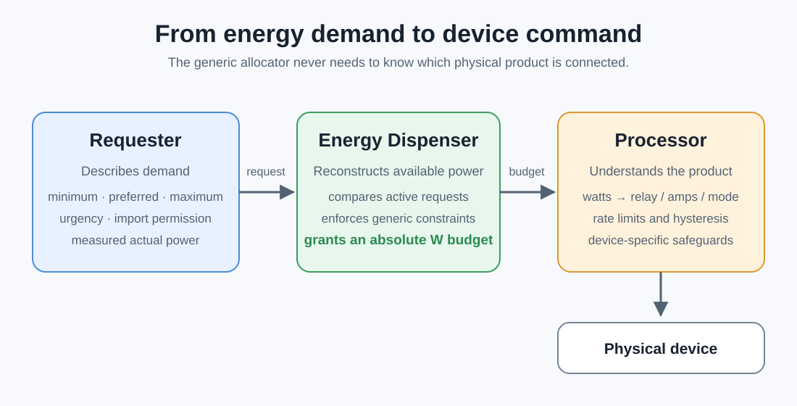
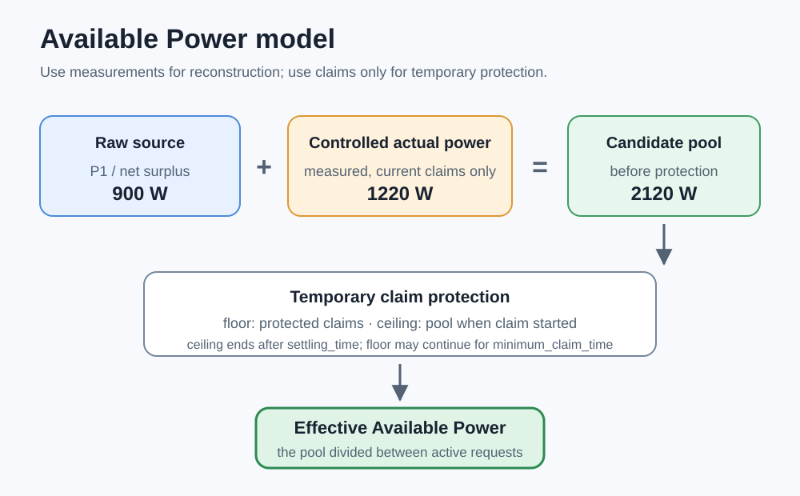

# Energy Dispenser v0.6.0

Central, consumer-driven energy allocation for Home Assistant.

The architecture deliberately separates generic watt allocation from
product-specific device control. Detailed feedback and timing semantics are
documented in [`docs/power-model.md`](docs/power-model.md).

## What is this?

Energy Dispenser is a generic power allocator. It knows about **energy demand**, not about boilers, EV chargers, heat pumps or washing machines.

<p align="center">
  
</p>

Energy Dispenser sits between the home's available-power measurement and its
flexible electrical consumers. It divides the available watts between requesters;
separate product-specific processors then translate each granted budget into
commands for devices such as an EV charger, battery, boiler, or climate system.
The central allocator itself remains independent of those device types.

A consumer can either be:

- **persistent**: configured in the Energy Dispenser UI and kept as a request until disabled;
- **digital**: reported by an automation/integration using `energy_dispenser.report`.

A separate processor can then apply `sensor.budget_<consumer_id>` to the real device.

## Safety disclaimer

Energy Dispenser is provided **"as is"**, without any warranty, express or
implied. The developers and contributors do not warrant that the software is
error-free, safe, reliable, or suitable for any particular purpose. Its
operation and results depend on the hardware, configuration, external systems,
and conditions in which it is used.

Use of Energy Dispenser is entirely at the user's own risk. To the fullest
extent permitted by applicable law, the developers and contributors shall not
be liable for direct, indirect, incidental, consequential, or other loss or
damage arising from use of, or inability to use, the software, including but
not limited to:

- increased electricity consumption or unexpected import from the electrical
  grid;
- damage to electrical appliances, EV chargers, batteries, or other connected
  equipment;
- damage to electrical installations or buildings;
- fire, overheating, or other safety incidents;
- financial loss or consequential damage;
- any other damage, loss, malfunction, or unsafe condition resulting from the
  software's operation, configuration, failure, or interaction with connected
  systems.

The user remains solely responsible for the configuration, supervision, and
safe operation of their electrical installation and connected equipment.

Energy Dispenser is supervisory software. It does not replace certified safety
systems, electrical protection devices, manufacturer safeguards, or
professional technical advice. See the full terms in [`LICENSE`](LICENSE).

## License

Energy Dispenser is licensed under the
**GNU Affero General Public License v3.0 (AGPL-3.0)**. You may use, study,
modify, distribute, and sell the software, provided that you comply with the
AGPL. In particular, distributed modified versions must remain under the AGPL
with their corresponding source code available. If a modified version is used
to provide functionality to users over a network, those users must also be
offered its corresponding source code.

The additional Energy Dispenser safety disclaimer remains applicable and does
not restrict the rights granted by the AGPL. See [`LICENSE`](LICENSE) for the
complete license and disclaimer.

## Available Power

The configured entity is the authoritative **raw source measurement**. Because
that measurement already falls when a controlled device starts consuming,
Energy Dispenser reconstructs the pool before controlled loads:

```text
candidate available power
    = raw source measurement
    + measured actual power of consumers with a current claim
```

Budgets, preferred power, maximum power, and uncontrolled loads are never added
to this formula. A temporary claim floor and settling ceiling protect the pool
while source and device sensors catch up with one another.

The complete model, timing behavior, tuning advice, and EV timelines are in
[`docs/power-model.md`](docs/power-model.md).

Consumer budgets remain **absolute power values**; they are never deltas.

An active requester with no allocation exposes a `0 W` budget. An inactive
requester exposes an unavailable budget because no request contract currently
exists. If the Available Power source itself is unavailable, active budgets
fail closed to `0 W` until the source recovers.

`Consumer Count` counts only active requests: enabled manual requests and active
automated requests. Inactive automated requesters are not counted.

### Slow consumers and reporting

A consumer may take time to react after receiving a new allocation.
`settling_time` creates a temporary floor and ceiling while control and
measurement feedback catch up. `minimum_claim_time` can keep the floor active
longer, but never extends the ceiling.

Digital consumers should report `actual_power` regularly when practical. The
Energy Dispenser's built-in requester reports every **2 seconds**. For a slow EV
charger this means the dispenser can observe the real power as soon as the charger
reports it, instead of waiting 20–30 seconds for the next requester report.

These are separate concepts:

- `settling_time`: measurement-stabilisation window after a claim starts;
- `minimum_claim_time`: minimum allocator protection for an existing claim;
- report interval: how often the requester sends state and actual power;
- `report_timeout`: how long an automated report lease remains valid.

Physical command hysteresis remains product-specific. An EV or air-conditioner
processor should not blindly apply every small two-second budget change.

Configured Available Power and actual-power entities are normalized from `mW`,
`W`, `kW`, or `MW` to watts. An entity without a unit is treated as watts for
input-number compatibility. Unsupported units make the source unavailable or
the optional actual-power measurement unknown.

Values sent directly through `energy_dispenser.report` must already be in
**watts (W)**. If a report template reads a kW sensor, convert it before
reporting (for example `1.216 kW * 1000 = 1216 W`).

### Request validation

Both persistent UI requests and digital reports use the same numeric contract:

- all numeric values must be finite;
- power and timing values cannot be negative;
- `minimum_power <= preferred_power <= maximum_power`;
- `urgency` and `surplus_value` are between 0 and 1 in digital reports
  (shown as 0–100% in the UI);
- `report_timeout` is at least 1 second.

The UI explains invalid configuration instead of saving it. An invalid digital
report is rejected in full; it is never silently clamped or reordered. If that
consumer already had a valid report, the valid report remains in effect until
its normal timeout.

## Request semantics

### minimum_power

Hard minimum. A consumer cannot start with a meaningless partial allocation below this value.

### preferred_power

The preferred operating point and marginal-value breakpoint. It influences allocation priority but does not replace the configured Available Power source.

### maximum_power

Hard upper limit. This is always enforced.

### urgency

Relative urgency from 0 to 100% in the UI.

### surplus_value

Relative value of taking additional surplus power from 0 to 100% in the UI.

### allow_import

Controls whether the consumer may buy grid power when the available surplus is not enough to satisfy its minimum. When `allow_import: true`, an active consumer may reserve its complete `minimum_power` even if that minimum is larger than the currently measured surplus. The available surplus is then fully reserved by that consumer; the remainder of its minimum is supplied by the grid, and downstream consumers receive no leftover surplus from that amount.

Dutch label: **Aankopen van netstroom toestaan**.

### Demand recipes

There is no separate demand-mode switch. The numeric request contract is the
single source of truth.

**Fixed/all-or-nothing load**

```text
minimum = preferred = maximum = 2000 W
```

The consumer receives either `0 W` or `2000 W`. With `allow_import: false`, it
starts only when its complete minimum is available from the surplus pool.

**Flexible load**

```text
minimum = 500 W
preferred = 1500 W
maximum = 2000 W
```

Once its hard minimum can be met, the consumer can receive any budget up to its
maximum. `urgency` influences allocation below preferred power;
`surplus_value` expresses the value of additional power above preferred.

**Low-value continuous surplus consumer**

```text
minimum = 0 W
preferred = 0 W
maximum = 2000 W
urgency = 0
surplus_value = 0.1
allow_import = false
```

This consumer can absorb small leftover slices and competes at a low marginal
value. A binary device with a non-zero hard minimum cannot currently express
strict “start only after every other preferred demand” ordering through a mode;
its product requester must decide when to become active, or a future explicit
priority tier must be designed.


## Configuration overview

The **Configure** screen shows a compact overview table containing both persistent/manual consumers and currently live digital consumers.

- Manual consumers have edit/delete actions through the configuration flow.
- Digital consumers are read-only because their configuration comes from their runtime reports.
- The selected **Available Power** source can be changed from the same Configure flow, with a live value preview before saving.

Each registered consumer also gets an `Actual Power <consumer>` diagnostic sensor. For digital consumers it shows the latest reported `actual_power`; for manual/form-configured consumers it uses the optional actual-power entity selected in the form. If no actual source exists, the sensor is unavailable rather than pretending the budget is measured power.

The integration intentionally uses the standard Home Assistant config-flow UI. It does not require a custom frontend panel for consumer management.

## A practical path: boiler first, then EV

Imagine that your home is exporting solar energy to the grid. You would rather
use those watts locally, but the devices that can consume them behave very
differently. Energy Dispenser gives those devices one common language: every
consumer describes what it can use in watts, and receives an absolute watt
budget in return.

### Step 1: start with an electric water boiler

A basic heating element is an easy model to understand because it is normally
either off or consuming its full rated power. A `2000 W` boiler can therefore
request:

```text
minimum = preferred = maximum = 2000 W
```

When the boiler needs heat and its complete minimum can be granted, its budget
becomes `2000 W`. Otherwise it receives `0 W`. The requester only reports that
demand; a separate processor reads the budget and safely controls the relay or
contactor. See the complete
[`electric-boiler`](examples/electric-boiler/) example.

### Step 2: add a flexible EV charger

After the boiler starts, there may still be solar surplus available. An EV
charger can usually consume that remainder more precisely because its current
can be adjusted. A single-phase charger might request approximately:

```text
minimum   = 6 A × measured voltage
preferred = 3000 W
maximum   = 20 A × measured voltage
```

The allocator still works only in watts. The EV processor converts the granted
budget to amps, applies whole-amp steps, and avoids sending a new physical
command for every small sensor change. See the complete
[`ev-charger`](examples/ev-charger/) example.

### Step 3: let both requests share the available energy

Suppose `4200 W` is available while the boiler and EV both want energy. The
fixed boiler can receive its complete `2000 W`, while the flexible EV can use
the remaining `2200 W`. If the available power changes, Energy Dispenser
recalculates both absolute budgets while respecting their minimums, maximums,
relative urgency, surplus value, and import permission.

This is the central idea: add more consumers without adding product-specific
branches to the allocator. Each requester describes demand, and each processor
understands its own device. Discrete limits may occasionally leave a small
remainder unused when no active consumer can meaningfully accept it.

Before connecting hardware, use the harmless
[`test-consumer`](examples/test-consumer/) example to observe allocation without
controlling a device. The complete learning order, persistent-request examples,
and compact report reference are collected in
[`examples/README.md`](examples/README.md).

## Visual documentation

Architecture and power-model diagrams live with the technical documentation,
not with the runnable examples.





The exact formulas and timing semantics remain authoritative in
[`docs/power-model.md`](docs/power-model.md).

## Unit tests

The allocator and power-budget calculation can be tested without physical
hardware. Installation, test commands, and covered scenarios are documented in
[`docs/testing.md`](docs/testing.md).

## 0.6.0

Initial public, HACS-ready release.

- Import-enabled minimum claims can exceed the currently measured available
  surplus. The complete `minimum_power` is allocated and the difference is
  treated as grid import, while `unallocated_power` remains zero so later
  consumers cannot spend the same surplus twice.
- Protected claims are explicit reservations during
  `settling_time`/`minimum_claim_time`. A temporary source drop below the
  consumer minimum cannot collapse an existing claim to zero before delayed
  actual-power feedback arrives.
- Allocation triggers are coalesced into one serial worker.
- Digital reports are also the liveness signal for digital-only consumers.
- A digital-only consumer disappears when its `report_timeout` expires.
- A form-configured consumer keeps its persistent request even without digital reports.
- Budget sensor IDs are based on stable `consumer_id` values.
- Raw Available Power is the configured source entity. Measured actual power
  from currently controlled consumers is added back; allocations are not.
- Built-in requester reports are emitted every 2 seconds.

## Installation

### HACS custom repository

Until Energy Dispenser is included in the default HACS catalogue, add its
public GitHub URL as a custom repository of type **Integration**:

1. Open HACS in Home Assistant.
2. Open the menu and choose **Custom repositories**.
3. Enter the Energy Dispenser GitHub repository URL and select
   **Integration**.
4. Download Energy Dispenser and restart Home Assistant.
5. Open **Settings → Devices & services → Add integration** and select
   **Energy Dispenser**.

HACS installs and updates `custom_components/energy_dispenser` automatically.

### Manual installation

Copy `custom_components/energy_dispenser` from this repository to
`/config/custom_components/energy_dispenser`, restart Home Assistant, then add
Energy Dispenser through **Settings → Devices & services**.

## Controlled-load feedback and settling

When a controlled consumer has an allocation, its measured `actual_power` is
added to the raw source value. During `settling_time`, the pool is bounded by a
claim floor and by the pool observed when the claim started. This prevents both
temporary collapse and temporary double counting. `minimum_claim_time` may keep
the floor active after settling, but does not retain the ceiling.

See [`docs/power-model.md`](docs/power-model.md) for exact formulas and worked
examples, including delayed EV feedback and overlapping sensor updates.
